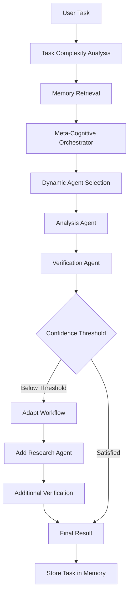
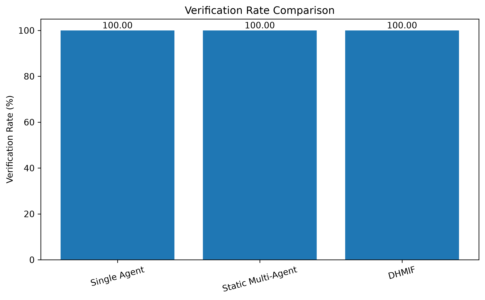
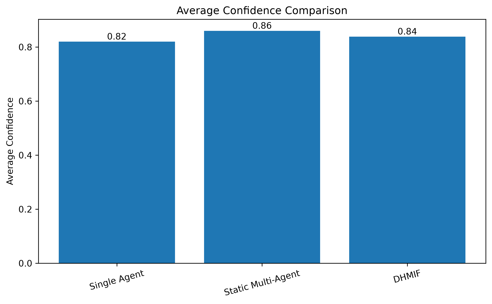
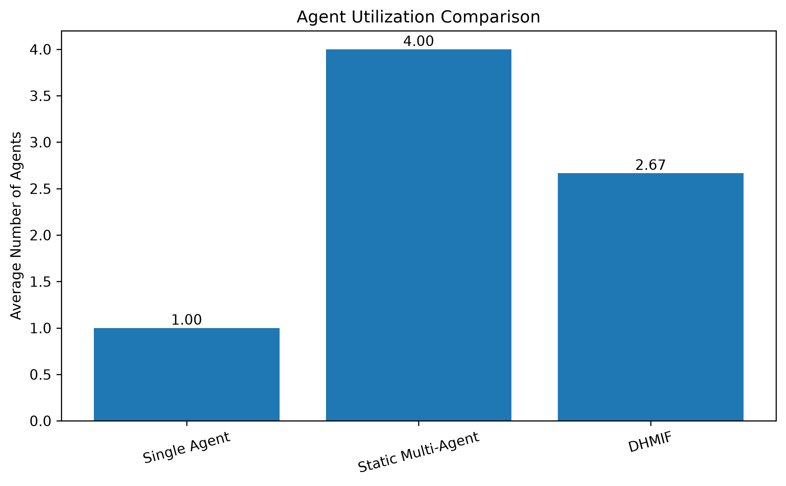
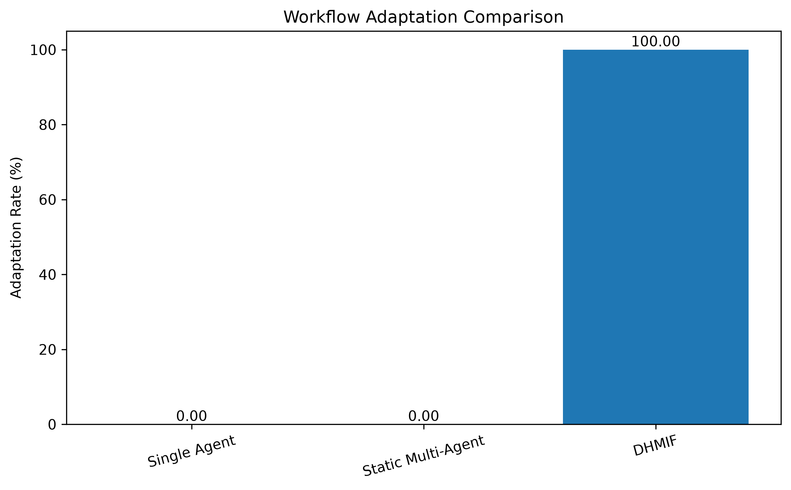
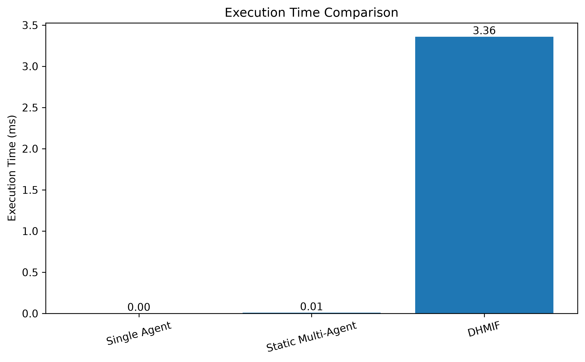

# 🚀 DHMIF — Distributed HyperGraph-Based Meta-Cognitive Intelligence Fabric

### Adaptive Multi-Agent Reasoning, Verification & Dynamic Workflow Orchestration

<p align="center">
  <strong>An adaptive multi-agent AI framework that dynamically coordinates specialized agents, evaluates intermediate results, and reconfigures workflows according to task requirements.</strong>
</p>

<p align="center">
  
  
  
  
  
</p>

---

## 📌 Overview

**DHMIF (Distributed HyperGraph-Based Meta-Cognitive Intelligence Fabric)** is an academic research project that explores adaptive coordination among multiple AI agents.

Traditional multi-agent systems often depend on predefined workflows. DHMIF explores a more flexible approach in which the workflow can change according to task complexity, intermediate confidence, and verification results.

The framework combines:

- Hypergraph-based workflow representation
- Meta-cognitive workflow orchestration
- Dynamic agent selection
- Confidence-based workflow adaptation
- Persistent task memory
- Output verification

The current implementation is a Python-based prototype demonstrating adaptive multi-agent workflow execution.

## 🎯 Problem Statement

Existing multi-agent AI systems can face several challenges:

- Fixed workflows that cannot easily adapt to changing tasks.
- Coordination overhead in centralized orchestration.
- Limited reuse of information from previous tasks.
- Inadequate validation of generated outputs.
- Difficulty selecting the appropriate number of agents for different tasks.

DHMIF explores an adaptive framework to address these challenges.

## 💡 Project Objectives

1. Design a hypergraph-inspired representation for relationships among tasks and agents.
2. Develop a meta-cognitive orchestration mechanism.
3. Dynamically select agents according to task requirements.
4. Incorporate persistent memory for previous task information.
5. Implement verification and confidence-based workflow adaptation.
6. Evaluate the prototype against single-agent and static multi-agent approaches.

## 🏗️ Proposed Architecture

DHMIF is organized around the following components:

| Component | Responsibility |
|---|---|
| Task Input | Receives the user's task |
| Task Analyzer | Estimates task complexity |
| Meta-Cognitive Orchestrator | Manages agent selection and workflow execution |
| Hypergraph Module | Represents relationships between workflow components |
| Analysis Agent | Performs initial task analysis |
| Research Agent | Provides additional research-style processing |
| Verification Agent | Evaluates outputs using programmed verification rules |
| Memory Manager | Stores and retrieves previous task information |
| LLM Module | Provides an integration point for language-model responses |

### Workflow



## 🤖 Specialized Agents

### 1. Analysis Agent
- Processes the user's task.
- Generates an initial analysis.
- Provides information for subsequent workflow stages.

### 2. Verification Agent
- Evaluates the generated output.
- Applies the prototype's verification rules.
- Produces a verification status and confidence score.

### 3. Research Agent
- Provides additional research-style processing.
- Is invoked when the workflow requires further processing.
- Uses the configured LLM integration when available.

## ⚙️ How DHMIF Works

1. The user submits a task.
2. The system analyzes its complexity.
3. Previous related tasks are retrieved from memory.
4. The orchestrator selects suitable agents.
5. The Analysis Agent processes the task.
6. The Verification Agent evaluates the result.
7. If confidence falls below the configured threshold, the workflow can adapt by adding another agent.
8. The system produces the final result and stores task information.

## 🛠️ Technology Stack

| Technology | Purpose |
|---|---|
| Python | Core implementation |
| Streamlit | Interactive dashboard |
| Gemini API | Experimental LLM integration |
| Matplotlib | Experimental result visualization |
| JSON | Persistent task storage |
| CSV | Experimental result storage |
| Git & GitHub | Version control and project hosting |

## 📂 Project Structure

```text
DHMIF-Project/
│
├── agents/
│   ├── analysis_agent.py
│   ├── calculation_agent.py
│   └── research_agent.py
│
├── core/
│   ├── __init__.py
│   ├── hypergraph.py
│   ├── llm.py
│   ├── orchestrator.py
│   ├── task_analyzer.py
│   ├── test_hypergraph.py
│   └── test_llm.py
│
├── experiments/
│   ├── experiment_runner.py
│   ├── dhmif_experiment_results.csv
│   └── graphs/
│       ├── adaptation_rate.png
│       ├── average_agents.png
│       ├── average_confidence.png
│       ├── execution_time.png
│       └── verification_rate.png
│
├── memory/
│   └── memory_manager.py
│
├── verification/
│   ├── __init__.py
│   └── verification_agent.py
│
├── dhmif_professional_app.py
├── main.py
├── requirements.txt
├── README.md
└── .gitignore
```

## 💻 Installation and Setup

### Prerequisites

- Python 3.13
- Visual Studio Code
- Git
- pip

### Step 1: Clone the repository

```bash
git clone https://github.com/yogithacirigiri/DHMIF-Project.git
```

```bash
cd DHMIF-Project
```

### Step 2: Create a virtual environment

```bash
python -m venv .venv
```

### Step 3: Activate the environment (Windows PowerShell)

```powershell
.\.venv\Scripts\Activate.ps1
```

### Step 4: Install dependencies

```bash
python -m pip install -r requirements.txt
```

### Step 5: Configure the Gemini API (if using LLM features)

Create a `.env` file in the project root if your implementation supports loading environment variables from it, or set the key in PowerShell:

```powershell
$env:GEMINI_API_KEY="YOUR_API_KEY"
```

Never commit your actual API key to GitHub.

### Step 6: Run the dashboard

```bash
python -m streamlit run dhmif_professional_app.py
```

Open the local URL displayed in the terminal, usually:

```text
http://localhost:8501
```

### Run the command-line prototype

```bash
python main.py
```

The command-line workflow may require a valid Gemini API key depending on the configured LLM integration.

## 📊 Experimental Evaluation

The prototype was evaluated across three task-complexity categories:

- Low Complexity
- Medium Complexity
- High Complexity

The following results are from the latest recorded complexity-wise experiment summary.

| Evaluation Metric | Low | Medium | High |
|---|---:|---:|---:|
| Verification Pass Rate | 100% | 100% | 100% |
| Average Confidence | 0.850 | 0.833 | 0.833 |
| Average Agents | 2 | 3 | 3 |
| Adaptation Rate | 100% | 100% | 100% |
| Average Execution Time | 3.673 ms | 4.761 ms | 5.923 ms |

### Evaluation Metrics

- **Verification Pass Rate:** Percentage of evaluated runs passing the implemented verification rules.
- **Average Confidence:** Mean confidence score reported by the prototype.
- **Average Agents:** Average number of agents used per task.
- **Adaptation Rate:** Percentage of evaluated workflows that underwent adaptation.
- **Execution Time:** Average time taken to execute the workflow.

**Note:** A 100% verification pass rate does not establish 100% factual accuracy. These are prototype-level results, not independently validated benchmark accuracy measurements.

### Experimental Graphs

#### Verification Rate


#### Average Confidence


#### Average Number of Agents


#### Workflow Adaptation Rate


#### Execution Time


## 🧪 Dataset and Evaluation Method

The current experiments use text-based task inputs rather than a standard public benchmark dataset.

Three configurations were considered in the comparative experiments:

1. Single-Agent System
2. Static Multi-Agent System
3. DHMIF Adaptive Multi-Agent System

The evaluation focuses on workflow behaviour, confidence, verification pass rate, agent usage, and execution time.

Evaluation using standard benchmark datasets and independent ground-truth labels is planned for future work.

## ⚠️ Current Limitations

The current implementation is a research prototype. Its limitations include:

- Execution is currently on a single machine.
- The hypergraph-based coordination is represented through Python modules rather than a fully distributed hypergraph infrastructure.
- Agent behaviour uses programmed logic in several stages.
- Memory retrieval uses keyword-based matching.
- Research processing depends on the configured implementation and LLM availability.
- Verification is based on programmed rules and does not guarantee factual correctness.
- Large-scale distributed deployment and scalability testing remain future work.

## 🔮 Future Enhancements

- Stable LLM integration.
- Semantic memory using vector embeddings.
- Distributed agent execution.
- Improved confidence estimation.
- Evidence-based verification.
- Conflict resolution among agents.
- Evaluation on standard public benchmark datasets.
- Scalability and performance testing.

## 👩‍💻 Project Team

**Department:** Artificial Intelligence and Machine Learning  
**Institution:** Malla Reddy University  
**Academic Year:** 2026–2027

**Project Contributors:**

- Yellu Pranayasri
- Yerrabelli Rishitha Reddy
- Yogitha Cirigiri

**Project Guide:** Manasa Chadupatla, Assistant Professor

## 🎓 Project Status

This repository contains the academic research prototype and its experimental implementation.

The proposed DHMIF architecture and its current proof-of-concept implementation are intended for further research, development, and evaluation.

## 📜 License

No open-source license has been selected yet. All rights and reuse permissions should be clarified before redistributing this project.

---

<p align="center">
  <strong>DHMIF — Towards Adaptive, Reliable and Intelligent Multi-Agent Systems.</strong>
</p>
